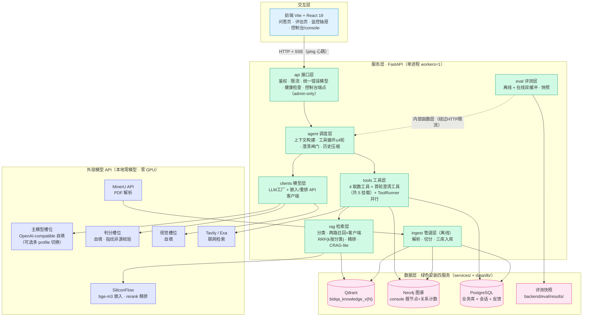
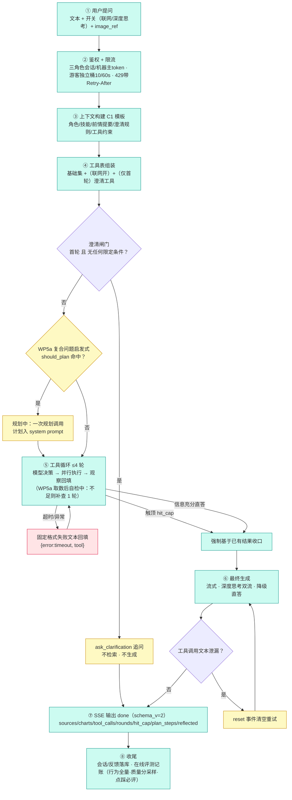
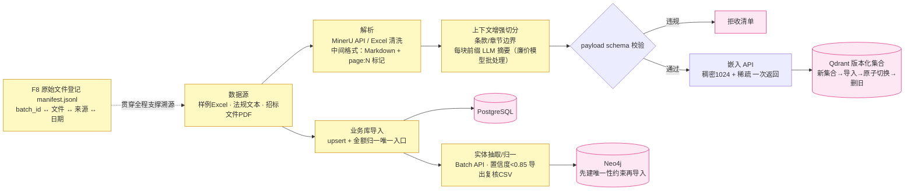
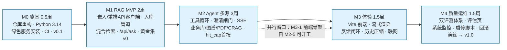

# 04 项目结构流程图（图解与走读）

> 上游文档：[01_系统框架设计](./01_系统框架设计.md) · [02_功能结构细化](./02_功能结构细化.md) · [03_项目规划](./03_项目规划.md)。
>
> **边界**：本文回答「系统长什么样、一次提问怎么流转、代码在哪」——图解 + 代码级走读 + 概念词典 + 文件地图。
>
> 参数与算法细节在 [核心算法](./核心算法.md)；接口契约在 [01 §3](./01_系统框架设计.md)。
>
> 与 01-03 同源，设计变更时同步更新本文件。

---

## 1. 总体架构图



> 依赖缺失时按 01 §5 配置三列表降级：能力型缺失=启动成功+health 显示降级；核心型（DeepSeek/Qdrant）缺失=启动失败。

## 2. 仓库结构

```text
bidding-qa-system-next/
├─ backend/
│  ├─ src/bidqa/          api · application · agent · tools · rag · clients · database · ingest · auth · eval · obs · cli · container.py
│  │  ├─ database/schema.sql   建表 SQL 单一事实来源（不引 Alembic）
│  │  └─ database/neo4j.py     NeoClient：7 类查询模板 + counts/relationship_counts（console 节点/关系双报）
│  ├─ tests/              与源码目录同构的测试（含 test_layering.py 分层守卫）
│  └─ eval/results/       评测快照 + 判分缓存（gitignore，滚动保留 100）
├─ frontend/              Vite + React 19 · 问答页 / 评估页 / 控制台
├─ services/              绿色服务：Qdrant/PG/Neo4j 安装目录（JDK21 随 Neo4j）
├─ deploy/                start/stop/status.sh 编排服务进程 · e2e-chat.sh 验收
├─ data/                  raw（manifest.jsonl 溯源登记）/ processed / db（绿色服务数据）/ run（日志+pid，gitignore）
├─ eval/golden/           黄金集 jsonl（agent_v0.jsonl 40 例）
├─ docs/                  设计文档 01-04 · 核心算法 · 部署手册 · AI交接 · 开发日志
├─ .auto/measure.sh       文档完整性机械审计（CI docs-audit job）
└─ 参考资料-招投标智能问答应用系统/  参考项目本地归档（gitignore，不入库）
```

> Python 3.14 + uv；模型面全 API 化——仓库内无模型权重、无 torch 依赖。

## 3. 一次问答的完整数据流



> 事件协议细节（ping/seq/schema_v/事件先后序契约）见 01 §3.4；量化验收（澄清 100% 触发、hit_cap<10%）见 02 §0.1。

## 4. 离线数据管道（ingest）



> 2026-11-10 接线：`bidqa ingest pdf` 已把 PARSE→CHUNK→VAL→EMB 串成生产入口（F2/F3 不再是孤立模块）；`ctx_summary` 改为可选（01 §4.1），VAL 只校验必填项，空摘要合法入库且不拼入 embedding 输入。本轮摘要模型未接（`chat=None`），F8 manifest 与 H6 一键汇总在后续一轮接入。

## 5. 里程碑路线（已全部交付，v1.0）



> 五个里程碑已全部收官（收官状态见 [03 §1](./03_项目规划.md)）；M2 起每周末回归黄金集 smoke 的节奏延续为日常验收（部署手册 §4）。

## 6. 一次提问的代码级走读（对照第 3 节数据流读代码）

以"输出3件安徽省最新的关于物业服务的中标项目"为例，从敲下回车到看到答案：

```
浏览器输入框（frontend/src/components/Composer.tsx，Enter 发送，IME 组词保护）
  └─ page.tsx send()：组装 user 消息 + 空 assistant 气泡，AbortController 带请求序号（A8 防旧流覆盖）
      └─ lib/sse.ts streamChat()：POST /api/chat/stream ——注意是【直连 127.0.0.1:8000】，
        不走 dev 代理（代理会把整个 SSE 缓冲到最后一次性吐，见开发日志 11-02）
          │  payload: conversation_id / message / web_enabled / thinking_enabled / provider / client_msg_id
          ▼
后端 api/chat/stream.py（POST /api/chat/stream，HTTP 适配壳）：
  0. 中间件鉴权（此前已过）：Bearer 机器主 token=管理员级 / 用户体系三角色会话令牌
     （豁免清单与门禁见 docs/01 §3.1）；身份存 request.state.identity
  1. 限流检查（按身份分桶：游客独立 10/60s，其余 30/60s）──超→ 429 + Retry-After
  2. 幂等检查 ──60s 内同 client_msg_id→ 409 错误码 4091
  3. 前置可用性 ──主模型没配→ 503 错误码 5031（流未开始就给明确错误）
  4. 起 worker 线程跑 application/chat/worker.run_chat_job（ChatJob 纯数据入参）；
     HTTP 线程进 SseChannel.lines() 循环：队列取事件→ SSE 行下发；15s 无事件→ ping
          ▼
run_chat_job：build_chat_for(provider)（clients/chat_factory）→ assembly.build_registry 装配
  工具表（四工具按可用性挂载，评测同款唯一实现）→ 历史：普通/管理员 load_history
  （application/chat/history.py；PG 最近 6 轮 + 滚动摘要 C7）；游客走进程内缓存（不落库）
  → AgentLoop.run()
          ▼
AgentLoop.run（agent/loop.py）：
  0. WP5a 规划（仅 AGENT_PLAN_ENABLED 且 should_plan 命中）：status「规划中」→ build_plan
     一次调用（主模型槽位）→ 计划入 system prompt + LoopResult.plan_steps（失败=[] 不阻塞）
  每轮：
  a. 上下文组装（agent/context.py）：角色规则/输出格式/工具选择指引（①②③分工，防 hit_cap）
  b. chat_stream_round（clients/llm.py）：流式 function-calling——
     content 增量实时转 token 事件（深度思考模式下抑制草稿直播，等重写后再流）
  c. 流末有 tool_calls？──有→ 伴随文本先发 reset 清屏；ToolRunner.run_batch 并行执行（30s 批量墙钟，
     超时返回固定格式 {"error":"timeout","tool":名}）；工具消息回填（arguments 必须是 JSON 字符串——
     这里踩过回传对象被 SenseNova 400 的坑）；轮数+1，回到 a（≤4 轮）
     └─无→ 收口 _finalize：泄漏检查（C4 四类正则，命中→ sanitize/重生成）→ 结果封装
          ▼
工具执行后（WP5a 自检，仅 AGENT_REFLECT_ENABLED 且恰 1 次）：status「自检中」→
  reflect_on_evidence（只带问题+取数摘要）→ need_more=true 且有余轮 → 注入 [证据自检]
  提示补查（LoopResult.reflected=true）；证据足够/失败/开关关=零分支
          ▼
工具内部（触发哪个看模型）：
  SearchKnowledgeTool → rag/retrieve.py 混合检索+重排（CRAG 兜底）
  SearchDatabaseTool  → database/bp_query.py build_bp_query（字段白名单、LIKE ESCAPE、日期窗）
  SearchGraphTool     → neo4j.py 七模板（实体 CONTAINS 过滤；subject_supplier 按标的物遍历）
  SearchWebTool       → tavily.py（缓存 10min，失败降级话术）
  查不到 → EMPTY_TEXT 固定兜底语（引导模型换路）
          ▼
收尾：build_done（assembly.py）打包 sources/charts/tool_name/rounds/hit_cap/phase_times/
  plan_steps/reflected（WP5b：schema_v=2，空值不省略；澄清轮 plan_steps/reflected 恒空）
  → done 事件下发 → persist_result 会话落库（done 收尾结构随 assistant item，刷新回放含执行计划/已补查）
  → defer_compress（C7 摘要压缩延后闭包，收尾事件之后执行）
  → G4 在线评测埋点（行为全量；采样率>0 时抽中轮判忠实度）
          ▼
前端渲染（MessageItem.tsx）：status 阶段条（含 规划中/自检中）→ thinking 折叠块 → token 逐段 Markdown 生长
  → done 后「执行计划」折叠列表（plan_steps 非空时，默认收起）+「已补查」徽标（reflected=true）
  + 来源卡片（默认收起，点 ▸ 展开）+ 图表（KPI 卡/横条，无数据不出图）
  → 👍👎 反馈（点踩会带 answer 回传 → G4 忠实度判分，60s 去重）
```

任何一步基建异常（LLM/检索/库全挂）→ application/chat/degrade.py direct_rag_answer 降级直答
（提示词与 /api/ask 同源 agent/prompts.py），`degraded` 字段记录原因，答案照样流出。

图片路径（v2.3 双通道，与上面主链并行，不是 Agent 工具）：
  选图 Composer 📎 → useImageAttachment.pickFile 只建档（本地 File，chip 即时出现，不上传）
  发送 page.handleSend → prepareForSend(docMode)：双压缩——预览 1024/0.85 给 Qwen 路由 +
  原件 2000/0.92 给 OCR（被丢弃的附件不产生任何视觉调用）
    → POST /api/vision → application/image/analyze.analyze_image 行为矩阵：
      mode=auto：Qwen 看预览一次调用回 {route, description}——路由 describe 用描述；
      路由 ocr 则 OCR 读原件（失败/空/缺原件兜底用描述并标 degraded=true）
      mode=ocr：手动按文档解析，跳过 Qwen 最省钱；mode=describe：强制通用描述
    → 描述存 RefStore（TTL 10min/64 条）换 image_ref → 聊天端点只传引用不传 base64
    → worker.image_context_block 以【图片内容 n】拼进问题（OCR 文本带【图片文字（OCR）】来源标记）

## 7. 核心概念词典

| 术语 | 大白话 |
|---|---|
| **三槽位** | 主模型 CHAT（问答）、视觉 VISION（v2.3 已上线：双通道图片解析）、判分 JUDGE（评测打分）。全部走同一套 OpenAI-compatible 适配器，换厂商只改 .env。v2.3 增 OCR 槽位（能力型第四槽：文档类图片按高分辨率原件提取文字，缺失=自动路由退化为 Qwen 描述） |
| **混合检索** | 常态走 dense（语义向量）+ sparse（学习式稀疏）两路独立召回，按 `Σ1/(k+rank)` 客户端 RRF 融合（k 由 E1 三分类注入）后再重排；BM25 是嵌入不可用时的灾备单路，不参与融合（踩过单路召回的坑，见开发日志 11-02 ①） |
| **CRAG** | 检索置信度兜底策略：召回质量差时纠正查询/降级，不让模型硬编 |
| **工具循环 / hit_cap** | 模型最多 4 轮"思考→调工具→看结果"；第 3 轮起注入收口提醒，第 4 轮强制收口（hit_cap 标记"触顶收口"）。目标 hit_cap 率 <10% |
| **澄清门** | 首轮问题是"数字意图但缺限定词"（如"中标金额是多少"）时，先反问地区/时间/口径，不做无意义检索 |
| **降级直答** | Agent 基建任何一环挂掉 → 自动切"无工具的检索+生成"直答，问答不断但标注降级（`degraded` 字段）。主/降级路径的耗时标签是两套，不合并 |
| **SSE 七事件** | `status`（阶段）→ `thinking`（思考流）→ `token`（正文增量）→ `done`（结构化结果）主链；`reset`（清屏重来，伴随文本/泄漏时）、`error`、`ping`（15s 心跳）。seq 单调递增防乱序 |
| **schema_v** | `done` 事件的结构版本号；给 done 加字段必须递增，前端好兼容 |
| **异源判分（5032）** | 打分的模型和被测的主模型不能是同一个（按端点+凭据+模型指纹校验），防"自己给自己打高分"；完全同指纹直接拒跑批 |
| **黄金集** | `eval/golden/agent_v0.jsonl`，40 个标准用例（法规/聚合/TOP-N/明细/图谱七类/澄清 + WP5c 多步/计划路径/反思补查/澄清边界，新例带 note），评测时逐个真跑 |
| **快照** | 评测结果的落盘，命名 `{kind}_{日期}_{git短hash}_{判分模型}.json`，原子写，滚动保留 100 个。**null=没测出 ≠ 0=得零分** |
| **判分缓存** | 判分结果按端点-模型分目录缓存，同题重跑不重复花钱；在线评测的点踩判分也回写这份缓存 |
| **在线评测（G4）** | 真实流量的旁路观测：行为指标全量免费（轮次/工具/延迟/降级），LLM 判分采样率代码默认 0（本机 .env 已开启 `ONLINE_EVAL_ENABLED=true`、采样 3%）；**用户点踩 → 忠实度单维必评**（60s 去重） |
| **EMPTY_TEXT 兜底** | 工具查不到数据时返回固定引导语（"无匹配数据。可尝试更换关键词…"），让模型知道该换路而不是干瞪眼 |

## 8. 代码地图（文件级重点）

| 路径 | 干什么 | 什么时候会碰 |
|---|---|---|
| `backend/src/bidqa/agent/loop.py` | **工具循环心脏**：流式 FC 轮次/工具回填/hit_cap/泄漏检查 | 改循环行为 |
| `backend/src/bidqa/agent/context.py` | 每轮的上下文组装（规则段+工具指引） | 调模型行为 |
| `backend/src/bidqa/agent/clarify.py` | 澄清门判定（确定性启发式） | 改澄清策略 |
| `backend/src/bidqa/agent/leaks.py` | 泄漏防护四正则 + 兜底解析 | 契约相关 |
| `backend/src/bidqa/api/chat/` | SSE 主端点拆件：schema（请求模型）/guards（幂等）/sse（传输机制）/
  stream（端点壳）——编排在 application/chat/{worker,history,degrade} | 加请求字段 |
| `backend/src/bidqa/rag/retrieve.py` | 混合检索（两路独立召回 + RRF，k 由分类注入）+重排+CRAG；`database/rrf.py` 为融合唯一入口 | 检索质量 |
| `backend/src/bidqa/application/image/` | 双通道图片解析（v2.3）：refs（RefStore/上下文块）/prompts（提示词+消息组装）/qwen（路由+描述 JSON 容错）/ocr（原件文字提取）/analyze（行为矩阵编排） | 改图片解析行为 |
| `backend/src/bidqa/api/vision.py` | POST /api/vision 适配壳：限流/413/400/5031 校验次序 + 存 ref | 加请求字段 |
| `backend/src/bidqa/ingest/` | Excel/FAQ 导入 + PDF 解析与增强切分（`ingest pdf` 生产入口）/归一化/三库导入（normalize_amount 单入口） | 换数据 |
| `backend/src/bidqa/application/admin/console.py` | 三库规模聚合（pg/qdrant/neo4j 节点+**关系**计数，任一库挂该节「不可用」）；`api/system/console.py` 为 30s 缓存端点壳 | 控制台数据面/加计数 |
| `backend/src/bidqa/database/` | PgConn 连接 + 三存储（bp_repo/conversations/feedback）+
  bp_query 纯函数查询 + factory + schema.sql + Neo4j（counts + relationship_counts：console 同时报节点与关系） | 数据层 |
| `backend/src/bidqa/auth/` | 三角色用户体系：identity（会话令牌）/passwords（scrypt）/store（users·sessions·app_settings 三表） | 改鉴权 |
| `backend/src/bidqa/cli/` | 运维入口：serve（workers=1 写死）/ doctor / eval（smoke·agent·rag·retrieval）/ ingest / prune / subject-batch / user | 加命令 |
| `backend/src/bidqa/eval/` | 离线评测（agent_eval/ragas/judge/retrieval_metrics/retrieval_eval）+ 在线评测（online.py） | 评测体系 |
| `backend/src/bidqa/obs/tracing.py` | OTel span 埋点收口（WP3）：setup/span/current_trace_id；默认 no-op，OTLP 可接 Langfuse/Jaeger（span 层级与隐私白名单见 docs/01 §6） | 加埋点/改观测后端 |
| `backend/src/bidqa/clients/llm.py` | 三槽位适配器 + 流式 FC | 换模型/协议 |
| `backend/.env` | 全部配置（用户自己管） | 配置变更 |
| `frontend/src/features/chat/` | 问答域拆件：useChatSessions/useChatStream/useImageAttachment（v2.3 双份上传）/
  useCapabilities/useTheme+theme/Sidebar/ChatPanel/UserBox/exportMarkdown（app/page.tsx 为薄壳） | UI 行为 |
| `frontend/src/lib/sse.ts` | SSE 解析（seq 防乱序/直连后端） | 流协议 |
| `frontend/src/lib/i18n.tsx` | 中英词典（界面文案唯一来源） | 加文案必改 |
| `frontend/src/components/SettingsDialog.tsx` | 设置面板（主题三档/语言/模型档位） | 加设置项 |
| `deploy/*.sh` | 启停/状态/e2e/演练 | 运维 |
| `data/run/` | 各服务日志 + pid 文件（gitignore） | 排障先看这 |
| `backend/eval/results/` | 评测快照 + 判分缓存 | 看质量趋势 |
| `参考资料-招投标智能问答应用系统/` | 参考项目本地归档（**不入库**） | — |
