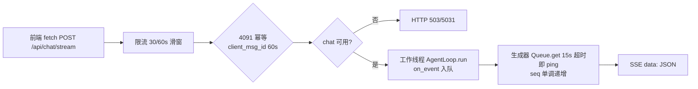

# 核心算法与组件机制

> **边界**：本文只回答「怎么算的、内部怎么转的」——算法流程/参数 + 组件内部机制。
> 检索参数的**单一事实来源**是 `docs/01` §4.1 检索参数表；接口契约在 `docs/01` §3；图解总览在 `docs/04`。

# 上篇 · 核心算法

## 1. 检索链路

**链路**：问题分类（E1，`rag/keywords.yaml`）→ 嵌入 API 双路编码（E2）→ 两路独立
`query_points` + 客户端 RRF 融合（E3，k 由 E1 注入）→ 重排 API 精排（E4）→ CRAG-lite 重检（E6，见 §4）。

- **双路编码**（`clients/siliconflow.py`）：bge-m3 稠密 1024 维 + 学习型稀疏**一次返回**；
  查询与文档走**同一 API 入口**（单测锁定——两侧不同入口则分数不可比，且看起来仍"正常"）。
- **灾备通道**（`rag/bm25.py`；命名沿用「BM25」，实现是**纯词频**，非标准 BM25）：jieba 切词 →
  `crc32(token) % (2^31-1)` 作稳定索引（免持久化词表、入库与查询两侧天然对齐，代价是哈希碰撞）→ 值 = 词频；
  **无 idf**（`SparseVectorParams()` 未开 `Modifier.IDF`，Qdrant 只算词频向量点积）、**无文档长度归一**
  （长 chunk 范数更大、点积偏高，系统性偏袒长文本——已知取舍，仅灾备路径用，优先级低）。ingest 双写
  `sparse_bm25` 向量；嵌入 API 不可用/断网时查询侧纯本地检索（`mode=bm25_fallback`），health 如实显示降级。
  **不引入第二家嵌入 API**（决策 #4）。
- **混合召回 / RRF**（`rag/retrieve.py`、`rag/rrf.py`）：两次独立 `query_points`
  （`using=dense` / `using=sparse`，各 prefetch 30），按 `Σ1/(k+rank)` 客户端融合，
  k = `classify(question)` 的 30/60/90 经 `query_hybrid(rrf_k=...)` 注入（勘误：旧实现用
  `prefetch + FusionQuery`，服务端固定 k=2，分类从未生效）；融合分只表达排名，不写进 `Hit.score`。
  再经重排 API 精排（候选 15，上限 30）取 top-5。
- **score 口径**（唯一入口 `retrieve.py`）：只有精排成功时 `Hit.score` 是 0~1 的 relevance；
  `bm25_fallback` 与未精排的 hybrid 一律为 `None`（RRF 排名分 / 点积分不冒充相关度，
  取不到记「不可用」，绝不记 0）。CRAG 阈值、前端相关度条、`quality_note` 均据此判断
  「有没有可比置信度」。
- **检索缓存**：`(question, top_k)` → 结果，进程内**有界 FIFO**（128 条，按插入顺序淘汰最早项，命中不提升）——实现是 FIFO 而非 LRU，命名与代码已对齐；淘汰策略未经命中率测量，勿顺手改成真 LRU。另注意 `result.elapsed_ms` 是首次（未命中缓存那次）检索耗时，缓存命中时随整个对象原样返回旧值，延迟统计须在调用侧自行计时。
- **实测基线（M2）**：混合召回 smoke 8/8、`retrieval_hit_rate 1.0`、P95 449ms（≤1.5s 达标）。**RRF k 接线后（2026-11-09）复测**：8/8、`retrieval_hit_rate 1.0`、P95 519ms（两路独立 `query_points` 使往返翻倍，仍在 ≤1.5s 验收线与 ≤1.2×449ms≈540ms 回归门槛内）。
- ⚠️ **灾备通道教训**：ingest 时嵌入不可用会只写 `sparse_bm25` 单路，此后 hybrid 恒空——
  **入库后必须复查检索 mode**（hit_rate 0→1.0 的根因，排障见部署手册 §6）。

## 2. 工具循环与澄清

**ReAct 状态机**（`agent/loop.py:AgentLoop.run`）：
- 每轮 `chat_tools(messages, tools)` → 无 tool_calls 即自然退出；有则 `ToolRunner.run_batch` 一轮内并行（整批 30s 墙钟）。
- 轮次 ≤ `MAX_ROUNDS=4`；倒数第二轮起注入触顶预警（hit_cap 治理实测 38%→15%）。
- 超时/未知工具/坏参数/异常统一 tool 消息回填（`tools/runner.py`），超时固定 `{"error":"timeout","tool":name}` 让模型可决策重试/放弃。
- 触顶：追加 `HIT_CAP_SECTION` 系统消息 + 无工具强制生成，`hit_cap=True` 计入评测。

**泄漏规则集（C4，`agent/leaks.py`）**：四类正则（中文调用语法 / tool_calls JSON 结构 / 代码栅栏含已注册工具名 / tool_call 标签）。
命中 → SSE `reset` → ①兜底解析真实执行（还有轮次时）②附反泄漏指令重生成一次 ③仍泄漏 `sanitize` 剥离保底。
契约：reset 后必现 status。

**澄清闸门（C5，`agent/clarify.py`）**：确定性判据 `is_underqualified` = 数字意图 ∧（地区/时间/标的物三者全无；
标的物=剥领域停用词+数字填充词后残留≥2连续汉字）。触发→仅追问不检索不生成；模型不配合时固定话术兜底
→ 无限定数字题 100% 触发（黄金集 ag-011~013 实测 3/3）。

## 3. 归一入口

- `ingest/normalize.py:normalize_amount`：`66万→660000`、`1.2亿→120000000`；布尔/负数/噪音→None（取不到绝不写 0）。
- `normalize_region`（`regions.py` 单一词表）：自由文本→省级；业务库导入省+市组合存 region（决策 #9）。
- 图表数值三重收口（`agent/assembly.py:sanitize_chart`）+ 内容寻址 id（sha256 前 12）。

## 4. CRAG-lite（E6，`rag/crag.py`）

首位**精排 relevance_score** < 0.35（阈值可配）→ 主模型改写检索词（一行≤200 字符）→ 重检一次 → 更优采用（记 `crag_rewrite`），
否则保留原结果诚实兜底。接入点：D1 工具 + `/api/ask`。`hits[0].score` 为 `None`（RRF 分 / 点积分不冒充相关度）时
**不触发改写**，降级文案写「不可用」而非 0.00——避免 k 变大后每次检索都多一次改写 LLM + 一次完整重检索。

# 下篇 · 组件机制

## 5. API 服务与请求生命周期

- 事件序契约 `status* → thinking* → token* → done|error`，`reset` 后必现 `status`（契约测试锁定）。
- 降级直答（C6）：Agent 基建异常 → `_direct_rag`，段名 `retrieve_ms/degrade_ms` 与主路径两套不合并。
- done 字段（B7 `agent/assembly.py`）：sources 跨轮去重深拷贝、charts 内容寻址、tool_calls 逐轮轨迹、hit_cap、phase_times、schema_v=1。
- **身份解析与分桶限流（用户体系，2026-11-08）**：中间件三段式——机器主 token（管理员级）→
  `USERS_ENABLED=false` 旧单机模式 → armed 时 sessions 表解析 opaque 令牌（可吊销；游客开关关闭即刻 403）。
  身份存 `request.state.identity` 供端点隔离数据（conversations 按 user_id 过滤，NULL=机器域，越权 404）。
  限流按身份选桶：游客独立滑窗（`GUEST_RATE_LIMIT` 10/60s，按会话 token），普通用户/管理员主桶按 user_id。
  游客不落库：多轮上下文走进程内 `_GuestHistory`（TTL 1h、封顶 6 轮、重启即失——与「不存历史」同一诚实语义）。

## 6. Agent 调度

C1 模板分节 → C2 挂载同源（基础 3 工具/联网仅开关/澄清仅首轮，未注册静默跳过=降级）→ C3 循环 → C6 生成。
深度思考：thinking 增量先缓冲后于 token 下发（契约序）；正文空时思考兜底。

## 7. 检索与灾备

常态：分类 → 嵌入 API（dense+sparse 同入口）→ 两路独立召回 + 客户端 RRF（k 按分类）→ 精排 → CRAG（仅精排 relevance 参与阈值）。
灾备：嵌入异常 → `mode=bm25_fallback`（查询侧 jieba 本地编码）。health 如实显示降级。

**检索质量标签**（`tools/runner.py:quality_note`）：成功路径的 tool 消息统一追加
✅/⚠️ 行——知识库按来源均分（≥0.5 ✅ / <0.5 ⚠️ 含条数与均分+换关键词建议）、
数据查询按图表数 ✅；失败/空结果已有结构化话术不重复贴。标签只进 tool 消息
不进用户正文，供模型决策「是否下一轮补查」（hit_cap 的护栏）。

**PG 反向匹配**（`database/bp_repo.py:query_bp` 兜底）：detail_search 正向落空
且关键词 ≥3 字时，改查「关键词包含字段值」（`%s ILIKE '%%' || project_name || '%%'`，
仅 project_name 降噪、char_length≥3 挡超短值全表命中）——解决 LLM 传参是实际
名称超集（带「招标公告」后缀）导致的假「未包含」。filters/date_range 在反向
变体里原样保留；psycopg 参数化下 SQL 文本字面 % 必须写作 %%。

## 8. 数据管道

业务库：表头映射→归一唯一入口→upsert ON CONFLICT(project_no,batch_id)（同批次=更新/跨批次=并存）。
PDF：MinerU→失败 pdfplumber 兜底→契约页码标记（生产入口 `bidqa ingest pdf`）。切分：章节>条款>FAQ>段落→块前缀 LLM 批摘要（失败留空、空摘要合法入库且不拼入 embedding 输入）。
图谱：约束先行→单 Cypher 条件 MERGE（空值不建节点）→归一<0.85 导出复核 CSV。

## 9. 联网结果相关性重排（参考 §15 吸收，2026-11-08；多供应商同日并入）

`SearchWebTool` 配置 `RERANK_*` 后，联网结果（非空时）以**检索 query** 为查询调
bge-reranker 重排：分数 min-max 归一 [0,1] 写回 `sources.score`（SourceCard 相关度条
直接可用）。与参考项目的两点差异：①参考按**用户问题**重排、本实现按检索 query——
`BaseTool.run(args)` 签名不动（工具只见自己的入参），query 由模型从问题派生，语义
近似；②参考缓存命中也重跑重排（缓存按 query、重排按 question），本实现归一后缓存（同 query 确定性，命中免跑）。降级语义：RERANK 未配置=现状（score 空）；重排失败/
结果全同分=score 空（**绝不记 0** 假装测过），来源顺序永不改变（text 块 [1..n] 对齐）。

**多供应商合并**（D4/D5）：供应商=WEB_SEARCH_PROVIDERS 名册（tavily/exa，可多个，
留空=关）；按配置序逐家检索 → URL 去重 keep-first → 重排作用于合并结果；缓存键
`("web", query, "供应商名册逗号连接", depth)`——名册变化即冷启动。部分供应商失败：
用成功者继续但**不缓存**（部分结果）；全败=诚实文案（与单供应商语义一致）。

## 10. 技能注入（C9，2026-11-08；二层匹配同日并入）

技能 = `agent/skills/*.md` 懒加载指令文件：首行 `# 名称`，`描述：`/`别名：` 头部行，
其余为正文。两层匹配：①每轮 run 前对**当前问题**做名称/别名子串匹配（英文大小写
不敏感）；②一层未命中且问题含指代词（该技能/这个技能/上述技能）→ 回看**最近一条
助手回复**提到的技能（name/别名，文件序首个）——参考项目三层匹配的第二层。
命中正文以 `【技能指令: {name}】` 拼接进 system prompt 的 [技能] 节——**零额外 LLM
往返**。无命中时 [技能] 节为空，prompt 与未启用一致。
运行期技能清单进程内缓存，新增技能文件需重启后端生效。
